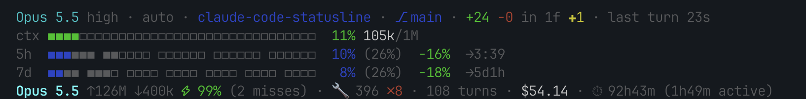

# claude-code-tally

A five-line status line for [Claude Code](https://claude.com/claude-code): model and git state, context fill, 5h and 7d limits with a pace guide, and per-session totals for every model, subagents included, counted from the session's transcripts. A POSIX `sh` script with no network calls.

Built on [tablesguru/claude-code-statusline](https://github.com/tablesguru/claude-code-statusline), which gave it the bars, the 5h and 7d pace and the review-scores line.



With several models and more git changes:

```
Opus 5 high · auto · web-portal · ⎇ main ↑2 ↓1 · +86 −12 in 5f ●2 ✚3 ?2 · last turn 13m04s
ctx ◼◼◼◼◼◼◼◼◻◻◻◻◻◻◻◻◻◻◻◻◻◻◻◻◻◻◻◻◻◻◻◻◻◻  24% 238k/1M
5h  ◼◼◼◼◼◼ ◼◼◼◼◼◼ ◼◼◼◼◼◼ ◼◼◼◻◻◻ ◻◻◻◻◻◻  61% (70%)  -9%   →1:30
7d  ◼◼◼◼ ◼◼◼◼ ◼◼◼◼ ◼◼◼◼ ◼◼◼◼ ◻◻◻◻ ◻◻◻◻  38% (71%)  -33%  →2d4h
Opus 5 ↑511.6M ↓1.6M ⚡96% (5 misses) · Sonnet 5 ↑28.9M ↓247k ⚡96% · Fable 5 ↑16.1M ↓84k ⚡98% · +1 more ↑1M ↓58k · 🔧 1532 ✗35 · 185 turns · $42.37 · ⏱ 52h10m (14h37m active)
```

## What each line shows

| Line | Parts |
| --- | --- |
| 1 | Model and effort · permission mode · repository or project folder · `⎇` branch, `↑`/`↓` ahead/behind · `+added −removed in N` files, `●` staged, `✚` unstaged, `?` untracked · how long the last turn took |
| `ctx` | Context window fill, then the tokens in the context / the window size |
| `5h`, `7d` | Plan limit used, `(pace)`, the difference from the pace, time until the reset (Pro and Max plans only) |
| last | Per model for the whole session: `↑` in, `↓` out, `⚡` cache share. Then `🔧` tool calls and `✗` errors, turns, cost, `⏱` session time and the time Claude actually worked. Shortened to fit a narrow terminal |
| review *(optional)* | Scores per round while a review loop of your own runs |

Every part in detail, and where each number comes from: [How it works](docs/how-it-works.md).

## Colours and the pace

- **`ctx`:** each filled cell is coloured by its position: green up to 15% of the window, yellow 15–20%, red above. On a 1M window that is where a session starts to get costly, since every request re-sends the whole context. The percentage takes its zone's colour; `⚠` from 75%.
- **`5h` / `7d`:** blue is what you used. Within the pace, grey filled cells run up to the pace. Over it, blue runs up to the pace and red shows the part beyond. The difference is green within the pace, red over it.

The pace is how much of the limit you would have used by now if you spread it evenly over the window: after 3 of the 5 hours, 60%. Under it, you won't run out before the reset at this rate. The 7d pace only moves during active hours (default 10:00–22:00 local; `ACT_START_HHMM`, such as `0900`, and `ACT_LEN_H` at the top of the script), so nights don't make you look under pace.

## Install

Requires `jq` 1.6 or later and `git` 2.15 or later. Runs on macOS and Linux with bash, dash or BusyBox `sh`.

```sh
./install.sh
```

It copies the script to `~/.claude/statusline-command.sh`, keeps a different existing one as a dated backup, and prints the `statusLine` entry for `~/.claude/settings.json`:

```json
"statusLine": { "type": "command", "command": "sh ~/.claude/statusline-command.sh", "refreshInterval": 10 }
```

`refreshInterval` keeps the totals and times moving while Claude waits for background agents.

To remove it: delete that entry, `~/.claude/statusline-command.sh`, any `~/.claude/statusline-command.sh.bak-*` backups `install.sh` made, and `~/.claude/statusline-state/`.

## Optional: live review scores

If you run reviews in a loop (a reviewer scores the code or a plan, Claude fixes the findings, the reviewer scores again), a sixth line can show the score of each round:

```
code-review  6,5 → 8,0 → 9,5
```

Nothing in Claude Code or this repo runs such a loop: the status line only reads a one-line file that your own review tool writes. With no file, or a file older than an hour, the line is hidden and costs nothing. To feed it, have the tool write the file for the repo under review and update it after each round:

```sh
RF="$HOME/.claude/statusline-state/loop-review/$(printf '%s' \
     "$(git rev-parse --show-toplevel 2>/dev/null || printf '%s' "$PWD")" \
     | sed 's#[^A-Za-z0-9]#_#g')"
mkdir -p "$(dirname "$RF")"
printf '%s\n' 'code|c:6,5;m:8,0;n:9,5' > "$RF"   # one round per segment, latest last
# rm -f "$RF" when the review is done
```

The format is `kind|sev:score;sev:score;…`. The kind becomes the label (`code` → `code-review`, `loop-review` when left out). Each score is shown as written and coloured by the worst finding of its round: `c` critical in red, `m` medium in yellow, anything else (`s` minor, `n` none) in green. The file is named after the git repo root, so scores never show up in another project.

This line comes from the original script by Kirill (tablesguru).

## Tests

`sh tests/run.sh` (or `sh tests/run.sh dash`) checks the totals against an independent count and many edge cases; see [How it works](docs/how-it-works.md#tests).

## License

MIT, see [LICENSE](LICENSE). Original work by Kirill (tablesguru).
